# 东软灵犀 · OpenHarmony 校园智能体

## 一、产品概述
面向校园和机构开展"教学精准辅助"所需的高灵活、强联通、低门槛的智能体(Agent)应用产品，创新性地融合了 OpenHarmony 操作系统与 ArkTS 编程语言的卓越优势。基于 OpenHarmony 开发创新应用，提升学生学习效率、优化教学体验、丰富校园生活，推动教育自动化、智能化发展。

我们集成了前沿的知识图谱技术(KG)以及强大的大语言模型（LLMs），**借助知识图谱的结构化知识体系构建能力，精准串联起计算机科学领域庞杂的知识点**，为学生呈现出清晰的知识脉络；同时，依托大语言模型出色的自然语言处理本领，实现智能交互的全面升级。

基于技术支撑展开功能设计：
- **专属智能体教学助教**：无论是疑难点知识解答，还是学习规划咨询，都能迅速得到精准回应
- **自动化生成学习笔记和思维导图**：助力学生将海量知识系统化、条理化，大大减轻学习负担
- **精心打造知识圈交流板块，引入社交驱动学习理念**：学生们在相互分享、探讨中拓展学习视野
- **采用最新的 ArkUI 框架，对用户界面进行深度优化**：从界面布局的精巧设计到交互操作的流畅体验，每一处交互细节都经过悉心打磨，力求为用户提供流畅且美观的使用体验，全方位赋能智慧校园场景

### 样例库（包含虚拟机演示视频一份,以及页面截图）

#### 1. 样机演示视频

#### 2. 核心应用界面展示

## 首页
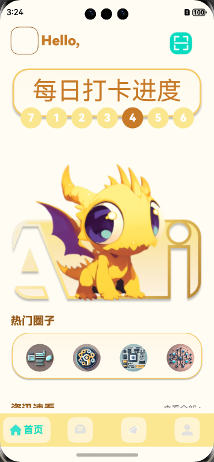

## 知识圈
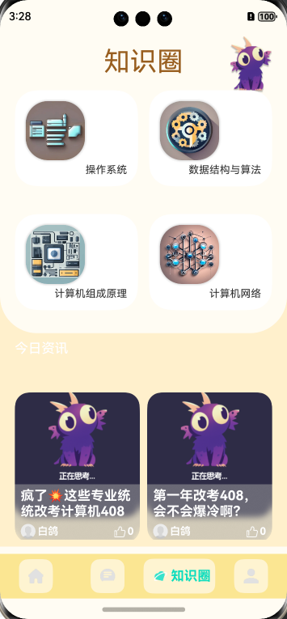

## 数据统计
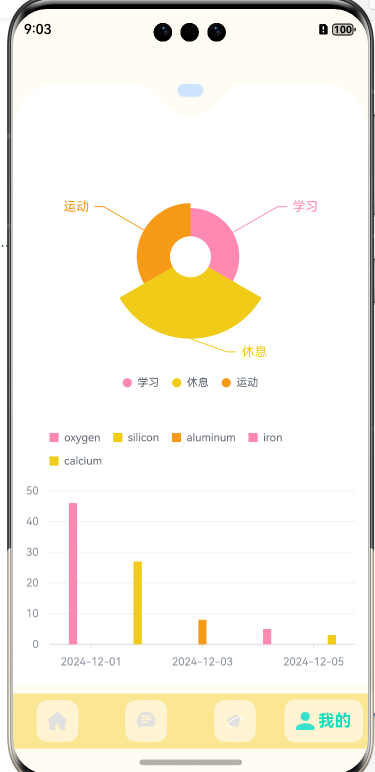

## 话题选择
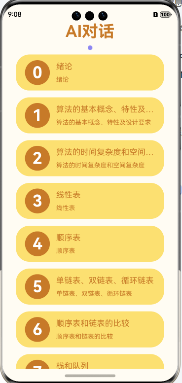

## 硬件控制

## AI对话
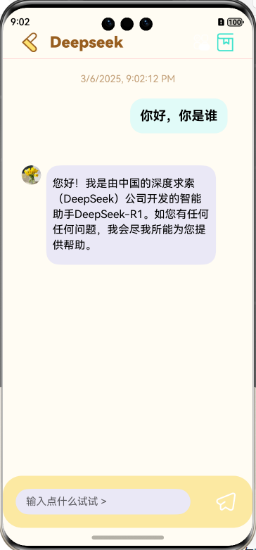

## 笔记编辑
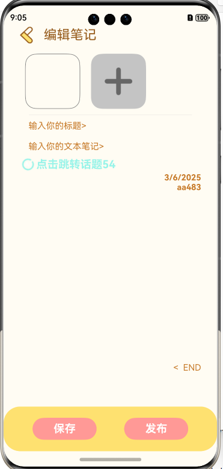

## 个人信息
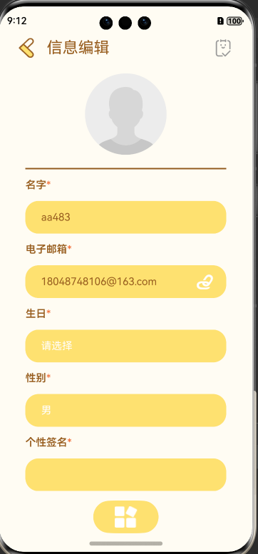

## 个人主页
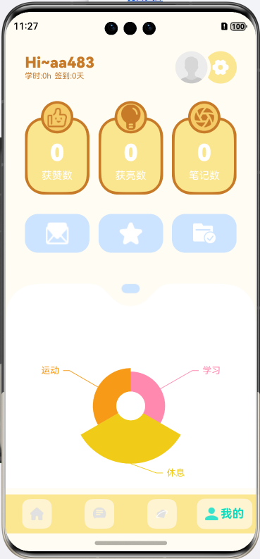

## 二、场景介绍
当前在线教育市场火热，用户群体不断扩大，服务需求也日趋多元。我们意识到，要在激烈的市场竞争中持续保持领先优势，亟需通过科技创新助力**教学质量**和**用户体验**的全面提升。

在评估了多种前沿技术的发展潜力后，我们锁定了知识图谱技术(KG)与大型语言模型(LLMs)在自然语言交互、知识理解等方面的卓越能力，决定开发一款"教学精准辅助"所需的智能体(Agent)应用产品，为广大学生提供个性化、智能化的学习服务。

该产品旨在打造一个全新的人工智能赋能教育的模式，覆盖国内外计算机科学教育体系中的各个学段、主流学科，满足学生在日常课业学习、知识拓展、考试备考等不同场景下的多元需求。通过创新的技术手段和产品理念，助力教育现代化进程，让每位学生都能享受到优质均等的教育资源和个性化的贴心服务。

## 三、用户需求分析
### 3.1 用户群体细分
作为一款面向群众的教育产品，我们需要全面分析不同用户群体的需求特点：

**学生群体：**
- 大一、大二学生（低年级段）:学习效率和知识理解是重点关注对象
- 大三、大四学生（中高年级段）:以应试备考为主,对专业解析和技巧指导需求较高
- 硕士备考生:注重核心考点掌握,对高考院校规划等需求较多
- 学困生:需要更多基础知识和动力的反复夯实

**教师群体：**
- 期望产品能够给出专业的教学指导和支持
- 需要获得学生的学习数据,实现精准教学
- 对产品的智能分析和疑难点解答功能有浓厚兴趣

### 3.2 需求矩阵分析
基于用户细分，我们进一步分析不同用户群体的核心需求。学生侧更看重知识掌握和个性化需求；教师侧对于知识传授、考核评测、学情分析等功能需求较高。这些差异化需求将作为我们设计产品功能的重要参考。

### 3.3 用户痛点深挖
除了上述明确需求,我们还需要深入挖掘用户在现有教育服务中所面临的痛点:
- **学习效率低下**  
  缺乏高效的学习规划和答疑解惑，学生容易陷入"学而不精、忘而重学"的怪圈。家长和老师难以及时发现和修正问题。
- **个性化程度低**  
  当前教育模式过于"一刀切"、缺乏差异化，难以满足不同学生个体的能力需求，导致教学效果大打折扣。
- **学习动力不足**  
  部分枯燥的内容缺乏吸引力，学生缺少内在学习动机，家长和老师未能及时发现和调整。

## 四、产品定位
面向校园和机构开展"教学精准辅助"所需的高灵活、强联通、低门槛的智能体(Agent)应用产品，我们给出如下明确定位：

一款面向高等教育阶段学生的智能化教育辅助工具，通过结合知识图谱与大型语言模型等前沿AI技术，为学生提供包括个性化学习规划、知识解惑、考点分析、能力培养等一系列高质量、高效率、个性化的在线教育服务。

## 五、功能设计
### 5.1 专属智能体学习辅导
**知识解惑：**
- 支持文字/语音/图像等多模态输入，系统将智能识别并解析用户提出的学习问题
- 融合知识图谱和领域知识库，给出准确、专业、通俗易懂的知识解答
- 辅以自动化生成学习笔记和思维导图,增强用户对知识点的理解和记忆

**知识延伸：**
- 基于用户提出的问题，主动识别相关的拓展知识点，推荐优质内容予以补充
- 设置情景化的模拟场景，激发学生思考，培养知识内化和转移能力
- 挖掘并推送最新前沿知识，增强学生的学科视野和创新意识

**个性内容推送：**
- 通过学习行为分析，动态构建学生的知识结构和掌握情况画像
- 结合已有学习进度、个人偏好，自动为每位学生推送适配的课程、习题、读物等
- 每周/月定期生成个性化"学习地图"，指导有序、高效的复习安排

### 5.2 个性化学习路径
**入门诊断评估：**
- 新生注册时，系统将根据年龄段为其安排基础能力和学科知识的综合测评
- 包括选择、填空、简答、编程等多种测试形式全面评估学生学科掌握水平
- 评估结果将生成可视化"知识画像"标注重难点供后续规划参考

**知识主线图谱：**
- 基于权威的学科课程大纲和教学体系构建出包含所有知识点的"主线图谱"
- 在图谱中体现知识点之间的先后罗辑关系、重要程度等属性信息
- 为每位学生贴合该主线图谱，高亮已掌握和欠缺的知识节点

**个性学习路径：**
- 将学生的知识画像、兴趣特点等因素与主线图谱进行智能比对
- 自动规划出精细的个性化学习路径，合理确定难易程度和进度安排
- 路径不是静态的将根据学习过程中的实时表现动态优化调整

**针对性复习：**
- 始终追踪学生的知识掌握轨迹，及时发现重点困难环节
- 智能安排针对性的课后复习安排，通过反复钻研夯实基础
- 同时关注学生的注意力和学习状态，适时插入小测验巩固知识点

## 六、技术挑战
## 6.1 技术难度
### 6.1.1 移动端部分的技术难点
#### 6.1.1.1 组件封装部分
为了方便管理以及减少代码冗余我们将各个页面的组件进行了单独封装，其中分为全局通用组件以及页面组件分别放在Component以及views文件目录下
1. 适配OpenHarmony 5.0的Vchart的图表定义使用。
2. 在OpenHarmony 5.0环境下的markdown实时解析适配mermaid图表生成。
3. 链接图片的实时保存预览以及放大使用。
#### 6.1.1.2 特殊方法封装
为了项目能够更流畅的开发我们封装了多个通用方法进行使用
  1. **用户数据存储鉴权工具**
  该方法使用鸿蒙PersistentStorage进行持久化存储用于将用户数据存储到磁盘当中。该方法也可以用于登录鉴权功能（可以分为方法鉴权以及跳转鉴权），它能够满足三种用户场景，第一种是用户还未登陆时点击鉴权内容则会跳到登录页进行登录操作，返回页面时会返回到登录前的页面，第二种则是在刚刚的基础之上提供了页面传递参数以及能够跳转回用户想去的对应页面。第三种如果用户调用了某些方法例如首页的扫码功能在未登录状态下也需要进行鉴权。

  2. **http 请求工具**
  我们在三方组件axios的基础之上又配置了请求拦截器以及响应拦截器。请求拦截器用来集中配置请求头的部分信息，可以更集中地处理请求参数减少代码冗余。响应拦截器用于抽离处理服务端传回来的数据，并且也可以进行token校验，若校验失败会通知用户重新进行登录操作。

  3. **埋点工具**
  埋点是在软件或应用程序的关键位置（如用户操作、事件触发、页面访问等）插入代码，以收集用户行为和应用程序性能数据的技术手段。学习时间可分为的情况1：进入试题页记录开始时间，离开试题页，生成一个埋点数据情况2：进入试题页，切换试题，生成一个埋点数据且记录开始时间...依次类推...离开试题页，生成一个埋点数据。

  4. **沉浸式工具**
  为了迎合手机主流全面屏，我们封装了该方法可以使app全屏覆盖，当然普通的三键导航依然适用。

  5. **日志工具**
  为了更高效的使用日志，我们基于鸿蒙的hilog封装了该方法。hilog相比于consolelog功能更为强大，HiLog 中定义了 DEBUG、INFO、WARN、ERROR、FATAL 五种日志级别供开发者使用，我们在此基础上又进行封装从而使日志更加清晰。

  6. **日志工具**
  实现一个控制状态栏的工具，可以快捷设置黑色和白色状态文字，可以根据不同的app主题色跟随对应的颜色状态。

  7. **图表实时渲染工具**
  可通过自定义种类数据参数和数据参数。根据用户给出的数据定义适用于OpenHarmony的spec并使用数据参数渲染图表。支持图标动画，预览数据，点击事件。

#### 6.1.1.3 数据的传输与渲染
**图表实时渲染工具：**
- 渲染的组件生命周期的关联管理：通过定义管理类数据统一管理组件状态与生命周期。

**组件渲染与赋值的关系处理：**
- 设置事件驱动型事件，采用预渲染，提前渲染的模式。优化用户体验

### 6.1.2 大型语言模型（LLMs）与知识图谱（KG）双引擎
**将非结构数据转化成结构化的数据：**
- 面向计算机科学领域知识图谱构建的信息提取方法。

**生成知识图谱：**
- 得到知识图谱后如何与大语言模型进行深度的结合，使用结构化数据去训练模型，并将知识图谱内嵌到搜索引擎当中进行检索，使得模型回答的时候能够关联搜索出来的知识。

  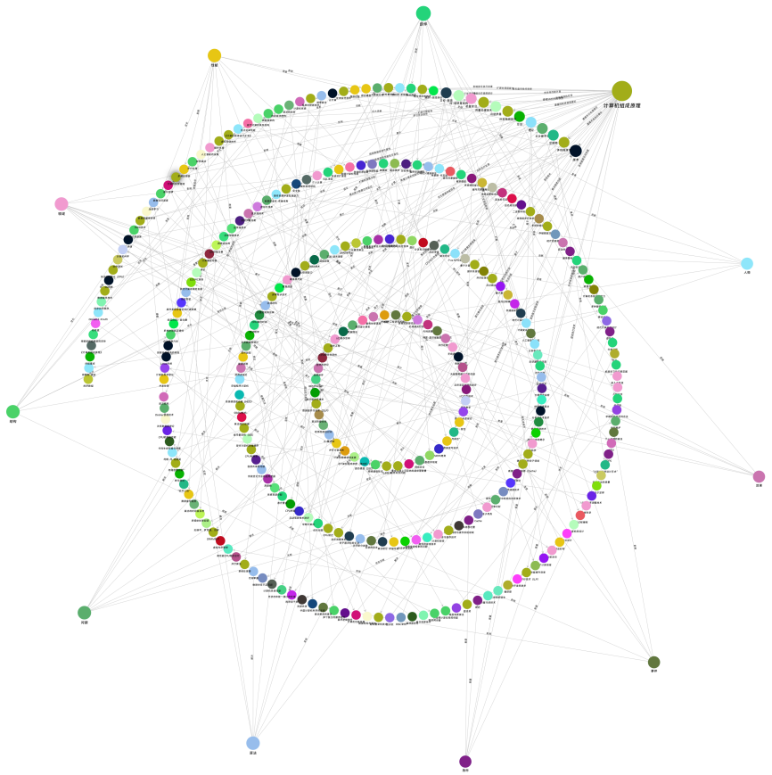

### 6.1.3 后端部分的技术难点

1.**数据库设计与选择**
- 关系型数据库在数据量增大时可能面临性能问题，需要考虑分表、索引优化等操作。
- 非关系型数据库如Redis需要对其数据结构和命令有深入的了解，并考虑数据持久化、缓存雪崩、缓存穿透等问题的处理。

2.**功能实现**
- 实现点赞和收藏的基本操作，包括记录用户的点赞收藏行为、更新相应的状态和数量等。
- 取消点赞收藏，需要正确地从数据库中删除相应的记录或更新状态。
- 防止重复操作，需要通过一定的逻辑来判断用户是否已经进行过点赞或收藏操作。
- 统计与展示，统计点赞收藏数量、热门内容等信息，并在前端进行展示。

3.**性能优化**
- 使用缓存技术，如Redis，减少数据库的访问压力。
- 异步处理，使用消息队列将点赞收藏请求异步化处理。
- 分布式架构，采用分布式数据库、分布式缓存、分布式锁等技术。

4.**安全与防刷**
- 用户认证与授权，确保只有合法登录的用户才能进行点赞收藏操作。
- 防刷机制，设计有效的防刷策略，如限制用户的操作频率、检查用户IP地址、使用验证码等。

### 6.1.4 权限认证
- 使用`sa-token`框架的全局过滤器完成权限认证，相比于拦截器，过滤器更底层、执行时机更靠前，有利于防渗透扫描，并且可以拦截静态资源方便权限控制。但过滤器也存在缺点，如无法率先拿到`HandlerMethod`对象，无法添加额外功能，需要对特殊路由做额外处理，且在Spring中过滤器抛出的异常无法进入全局`@ExceptionHandler`。

## 6.2 技术先进性
所采用的技术为当前行业前沿，有使用到最新的技术或方法。

### 6.2.1 AI模型
- **基于BERT的BiLSTM-CRF模型**：我们采用了一种先进的自然语言处理模型，该模型结合了BERT预训练模型的上下文语义理解能力和BiLSTM-CRF的序列标注能力。利用BERT预训练模型获取输入语料的字向量，然后通过BiLSTM层进行编码，最后CRF层解码输出每个字符的标签类别。这种模型的应用不仅提升了信息提取的准确性，而且增强了模型对复杂语义的理解能力。

- **知识图谱嵌入搜索引擎**：我们将知识图谱通过embedding模型嵌入到搜索引擎中，使得大语言模型在搜索和回答问题时能够关联到结构化的知识图谱数据。这种技术的运用极大地提高了搜索结果的相关性和准确性，同时也增强了模型对复杂查询的处理能力。

- **模拟AI对话应用场景1**：我们定向训练的AI助教：AI助教提供易错点和知识点补充；同时，标明引用材料，并提供电子版学习资料在线查阅功能。

  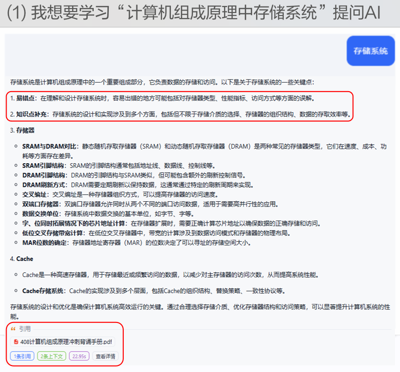

- **模拟AI对话应用场景2**：传统的AI产品往往以宏观视角，泛泛的输出，虽然这种打法看似全面，却缺乏深度和针对性，显得虚无缥缈。经过我们改良，让AI助教关联考点，同时，设计案例教学板块。

  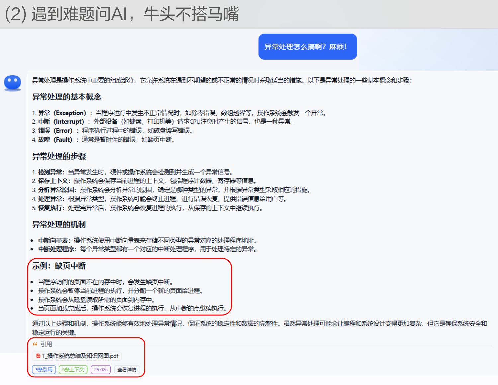

- **模拟AI对话应用场景3**：用户先提问“平衡二叉树的插入“，又问了“插入的位置如何找”。 我们提供这样一个工具能把数条冗杂的数据集合并处理。下一次，另一用户搜索“平衡二叉树的插入”的时候，接受到的答复会更优。

  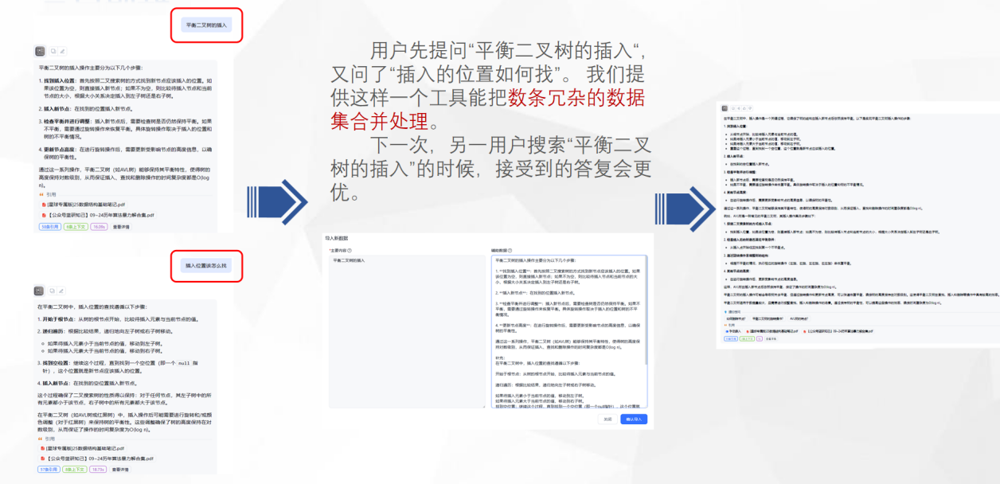

- **模拟AI对话应用场景4**：多模态问答，AI精准理解照片内题目内容，进行回答。

  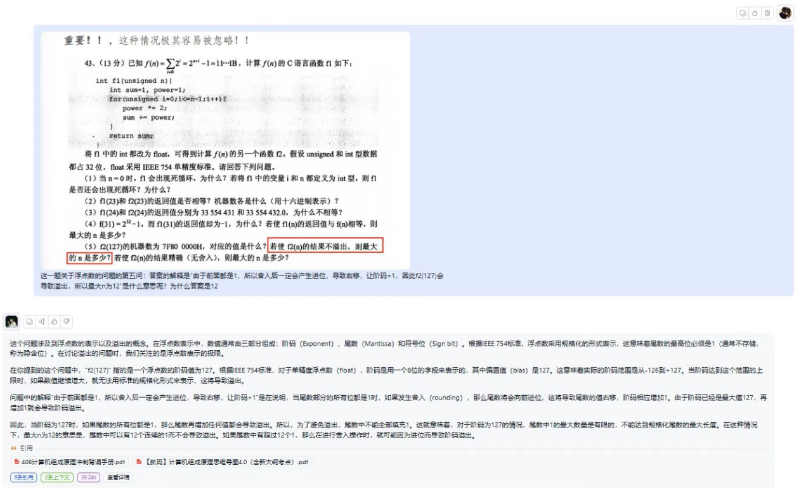
- 技术融合亮点，作为智能体能力的升级，我们创新性引入阿里云百炼大模型平台旗舰产品 DeepSeek-R1 满血版，与既有知识图谱（KG）及 ArkTS 技术栈深度融合，构建"三引擎驱动"的智能教学中枢。
### 6.2.2 其他技术亮点
- 在权限认证方面，我们使用了`sa-token`框架，这是一个轻量级的Java权限认证框架，它支持登录认证、权限认证、分布式Session会话、微服务网关鉴权、SSO单点登录、OAuth2.0统一认证等功能，体现了在安全认证方面的技术先进性。
- 在数据库方面，我们根据数据量和并发量的需求，灵活选择了关系型数据库和非关系型数据库，展现了在数据处理方面的技术先进性。
- 在性能优化方面，我们采用了缓存技术、异步处理和分布式架构等先进技术，以提高系统的性能和可扩展性。

## 6.3 技术稳定性
我们的技术解决方案经过精心设计，确保了系统的稳定性和可靠性，无潜在技术风险。

### 6.3.1 AI模型稳定性
- **基于BERT的BiLSTM-CRF模型**：该模型结合了BERT预训练模型的稳定性和BiLSTM-CRF在序列标注任务中的成熟应用，确保了模型在处理复杂语义和序列标注任务时的稳定性和准确性。
- **知识图谱嵌入搜索引擎**：通过将知识图谱嵌入到搜索引擎中，我们确保了搜索引擎的稳定性和响应速度，同时提高了搜索结果的准确性和相关性。

### 6.3.2 系统架构稳定性
- **权限认证框架**：使用`sa-token`框架进行权限认证，该框架经过广泛测试和社区验证，确保了权限认证的稳定性和安全性。
- **数据库选择与优化**：无论是关系型数据库还是非关系型数据库，我们都采用了成熟的数据库解决方案，并结合了索引优化、分表策略等技术手段，确保了数据库操作的稳定性和性能。
- **性能优化措施**：通过缓存技术、异步处理和分布式架构，我们确保了系统在高并发和大数据量下的性能稳定性，同时也提高了系统的可扩展性。

### 6.3.3 安全与防刷机制
- **用户认证与授权**：采用JWT等成熟技术进行用户认证和授权，确保了只有合法用户才能进行操作，增强了系统的安全性。
- **防刷策略**：通过限制操作频率、IP检查等措施，我们构建了有效的防刷机制，保护系统免受恶意攻击，确保了系统的稳定性。"内容不变，完善markdown格式，使美观。

## 七、技术实现
  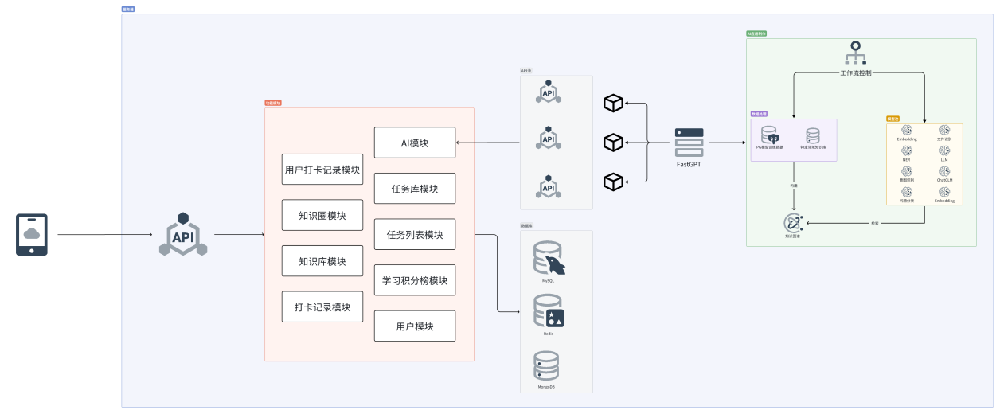
  
## 八、万物互联
### 8.1 功能实现
- **通过app控制灯和空调**：利用ESP32开发板，结合WiFi库和ESPAsyncWebServer库，实现了通过app对灯和空调的远程控制。用户可以通过发送HTTP请求来控制继电器的开关状态，从而实现对灯和空调的控制。
- **小智AI助手**：在原有的AI助手基础上进行了二次开发，用户可以与小智AI助手进行对话，对话记录会在app上显示并同步保存。我们还专门定制了校园智能体AI助手，为用户提供更贴心的服务。

### 8.2 数据库设计
- **设备表**：记录了设备的类型、名称、位置、请求地址、状态等信息。设备类型包括灯、AI助手和门锁等，状态有开、关、开锁、关锁等。
- **操作日志表**：记录了用户对设备的操作日志，包括用户ID、设备ID、IP地址、操作和时间戳等信息，方便对设备的操作进行追溯和管理。

### 8.3 技术实现
- **WiFi连接**：使用WiFi库连接到指定的WiFi网络，确保设备能够与app进行通信。
- **异步Web服务器**：采用ESPAsyncWebServer库创建异步Web服务器，监听端口8080，处理来自app的HTTP请求。
- **继电器控制**：通过控制继电器引脚的电平来控制灯和空调的开关状态，根据继电器的类型（常开或常闭）进行相应的逻辑处理。
- **HTTP请求处理**：在服务器的"/update"路由中处理来自app的HTTP GET请求，获取请求中的参数，控制继电器的状态，并返回HTTP响应。
- **日志记录**：在设备操作时，将操作信息记录到设备表和操作日志表中，便于管理和查询。

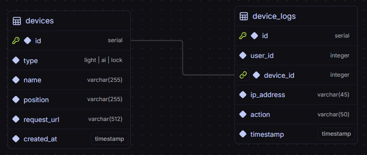
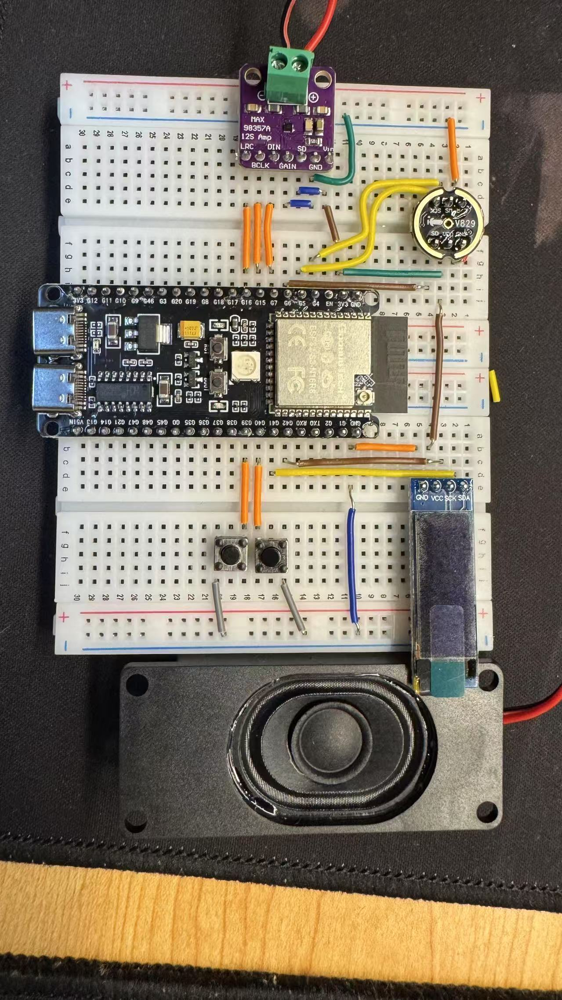